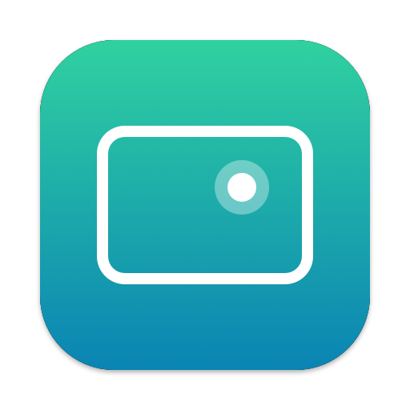
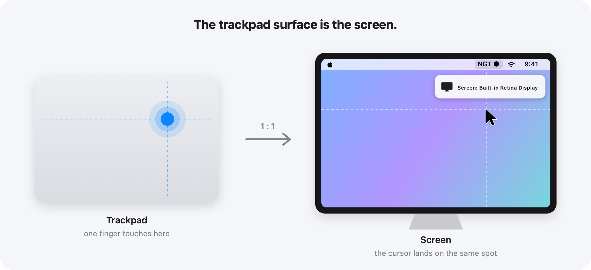

<div align="center">



# NGT · Next Generation Touchpad

**Turn your Mac trackpad into a graphics tablet.**

Touch a spot, and the cursor is already there.


</div>

---

A normal trackpad is *relative*: you drag the cursor from point A to point B. NGT makes it *absolute*: the trackpad surface **is** the screen. Touch the top-left corner and the cursor is instantly at the top-left of your screen. Touch the middle and it's in the middle. No more swiping across a big display.

Built for focused work where you need to move fast between far-apart buttons, panels and windows.

<p align="center">
  <picture>
    <source media="(prefers-color-scheme: dark)" srcset="docs/illustration-dark.png">
    
  </picture>
</p>

## ✨ Features

|   |   |
|---|---|
| 🎯 **Absolute positioning** | One finger maps 1:1 to the screen. |
| ✌️ **Gestures still work** | Two or more fingers scroll and swipe as usual. |
| 🖱 **Clicks land where you touch** | Works with both physical clicks and tap-to-click. |
| 🖥 **Multi-screen** | Pick the target display from the menu, or cycle with **⌃⌥→ / ⌃⌥←**. A *"Screen: …"* banner confirms the switch. |
| 🔌 **Remembers your screen** | Falls back to the main display when a monitor is unplugged, and returns when it's plugged back in. |
| 📍 **Menu bar only** | No Dock icon. Toggle *Tablet Mode* on and off at any time. |
| 🪶 **Featherweight** | A single ~75 KB native binary. No timers or polling, ~0% CPU when idle. It only works while a finger is on the trackpad. |

## 🚀 Getting started

**Requirements:** macOS 11 Big Sur or later, and the Xcode Command Line Tools (`xcode-select --install`).

```sh
git clone https://github.com/faithere1/NGT-NextGenerationTouchpad.git
cd NGT-NextGenerationTouchpad
./build.sh
open NGT.app
```

On first launch macOS asks for **Accessibility** access (System Settings → Privacy & Security → Accessibility). Turn on **NGT**, then quit and reopen it. The menu bar shows **NGT ●** when it's active.

> **Tip:** Drag `NGT.app` into `/Applications` to keep it around.

## 🖱 Usage

| Action | What happens |
|---|---|
| One finger on the trackpad | Cursor jumps to that spot on the screen |
| Two or more fingers | Normal scrolling and gestures |
| **⌃⌥→ / ⌃⌥←** | Switch to the next / previous screen |
| Menu → *Tablet Mode* | Turn absolute mode on or off |
| Menu → *Screen* | Choose the target display |

The menu bar item shows the current state: **NGT ●** on, **NGT ○** off, **NGT ⚠** needs attention (for example, missing permission).

## ⚙️ Configuration

Tweak the constants at the top of [`ngt.m`](ngt.m) and rebuild:

| Constant | Default | Meaning |
|---|---|---|
| `kEdgeMargin` | `0.03` | The outer 3% of the trackpad maps to the screen edges, so corners are easy to reach. |
| `kClickGrace` | `0.35` s | How long after lifting a finger a click is still pinned to the touch point (for tap-to-click). |

## 🔍 How it works

1. **Read:** `MultitouchSupport` delivers raw, normalized finger positions (0–1) from the trackpad.
2. **Map:** a single-finger touch is mapped to the target display's bounds, and a mouse-move event is posted there.
3. **Pin:** a Quartz event tap pins the trackpad's own relative mouse events (moves, drags, clicks) to that absolute point, so the cursor never drifts.

Everything lives in one file: [`ngt.m`](ngt.m).

## ⚠️ Notes & limitations

- **Rebuilding resets permission.** Each build gets a new ad-hoc signature, so macOS invalidates the old Accessibility grant. `build.sh` clears the stale entry automatically. Just re-enable NGT once after each build.
- **Uses a private Apple framework** (`MultitouchSupport`) to read raw finger positions. Many trackpad utilities rely on it, but it's undocumented, so a future macOS update could break it.
- **Sleep / reconnect:** if tablet mode stops responding after the Mac wakes or a Magic Trackpad reconnects, quit and reopen NGT.
- **Aspect ratio:** the trackpad and screen have different proportions, so drawn shapes are slightly stretched.

## 📄 License

[MIT](LICENSE) © faithere1
